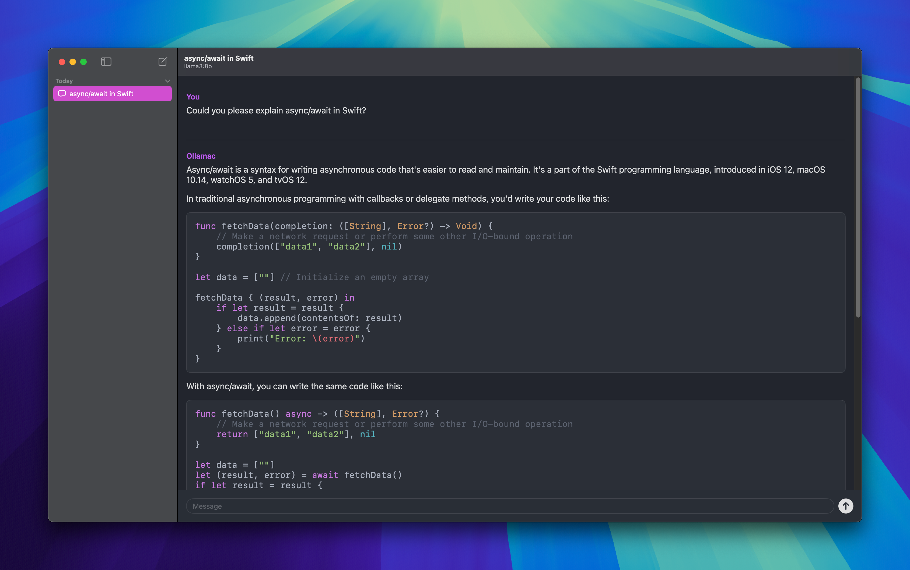

# Adel Intelligence

Adel Intelligence is a native macOS chat client for [Ollama](https://ollama.com/). It lets you run conversations with local AI models while keeping the experience fast, focused, and private.

## Requirements

- macOS 14 Sonoma or later
- [Ollama](https://ollama.com/) installed and running
- At least one Ollama model downloaded locally

## Getting started

1. Install Ollama from [ollama.com](https://ollama.com/).
2. Download a model, for example:

   ```bash
   ollama pull llama3.2
   ```

3. Open Adel Intelligence.
4. Choose a model and start a conversation.

The default Ollama server is `http://localhost:11434`. You can change the host from the app’s chat preferences when using a local or remote Ollama server.

## Features

- Native SwiftUI macOS interface
- Conversations with local Ollama models
- Custom Ollama host configuration
- Streaming responses
- Conversation history stored locally with SwiftData
- Markdown rendering and syntax-highlighted code blocks
- Chat comparison tools for reviewing responses from other assistants
- Adjustable font size and light/dark appearance support

## Screenshots

<p align="center">
  
  
</p>

## Build from source

1. Clone the repository:

   ```bash
   git clone https://github.com/AdelMohamedS/adel-intelligence.git
   cd adel-intelligence
   ```

2. Open `Adel Intelligence.xcodeproj` in Xcode.
3. Allow Swift Package Manager to resolve the project dependencies.
4. Select the Adel Intelligence target and run it on macOS.

## Contributing

Bug reports, accessibility feedback, and focused improvements are welcome through [GitHub Issues](https://github.com/AdelMohamedS/adel-intelligence/issues) and pull requests.

## Acknowledgements

Adel Intelligence uses open-source libraries including [OllamaKit](https://github.com/kevinhermawan/OllamaKit), [ChatField](https://github.com/kevinhermawan/ChatField), [Defaults](https://github.com/sindresorhus/Defaults), [Sparkle](https://github.com/sparkle-project/Sparkle), and [MarkdownUI](https://github.com/gonzalezreal/markdown-ui).
